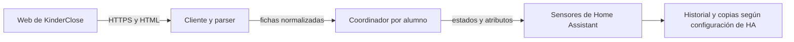

# Arquitectura y contrato de datos

## Alcance y flujo

KinderClose es una integración personalizada de Home Assistant, distribuida con la estructura que espera HACS. No incluye servidor propio ni base de datos. Para cada alumno configurado se crea una entrada y un coordinador independiente:

El flujo de configuración comprueba las credenciales y resuelve el alumno. El coordinador consulta cada 15 minutos en un executor, para no bloquear el bucle de Home Assistant. El cliente reutiliza una sesión HTTP por entrada, vuelve a autenticarse una vez si caduca y la cierra al descargar la integración. Las redirecciones se limitan al mismo origen HTTPS.

La fuente es HTML de la web de KinderClose, no una API pública documentada. Los cambios de la web pueden romper la extracción; el parser rechaza páginas sin los paneles esenciales. Las pruebas usan respuestas simuladas, no verifican la web real.

## Datos y semántica

El cliente obtiene los enlaces de fichas del perfil, elimina duplicados y consulta hasta los primeros cinco en el orden ofrecido por la página; después ordena esas fichas por fecha descendente. Por tanto, la ficha presentada es la más reciente **entre las consultadas**: depende de que KinderClose ofrezca primero las fichas más recientes. No se consulta el historial completo.

| Campo interno | Significado y tratamiento |
| --- | --- |
| `alumno_id` | Identificador del alumno, también usado en el dispositivo y los identificadores de entidades. |
| `consultado_en` | Momento de consulta en UTC, en ISO 8601. |
| `fichas` | Lista no vacía de fichas consultadas, ordenadas por fecha descendente. |
| `fecha`, `url` | Fecha ISO de la ficha y enlace de origen. No representan necesariamente el día actual. |
| `presencia`, `comidas` | Valores de texto extraídos de los paneles; los campos vacíos o `--` se normalizan a `null`. |
| `sueno` | Sesiones con `desde` y `hasta`; si faltan horas, pueden ser `null`. |
| `sueno_minutos` | Suma de sesiones completas en minutos; `null` si no hay sesiones o alguna está incompleta. Se admite el cruce de medianoche. |
| `deposiciones` | Lista de objetos `tipo`, `hora` e `info`; sus campos pueden ser `null`. |

Cada sensor toma su estado de la primera ficha. El sensor de asistencia interpreta `Sí` o `Si` en `ausente` como ausencia y `No` como presencia. El sensor de deposiciones cuenta los elementos de la lista; una lista vacía da cero. La ausencia de sesiones de sueño da un valor desconocido, no cero. Los atributos comunes son `fecha_ficha` y `url_ficha`; el sensor `ultima_ficha` expone las fichas consultadas y el momento de consulta, y los sensores de sueño y deposiciones exponen sus detalles.

Los nombres visibles se traducen con `translation_key`; los `entity_id` se fijan explícitamente para que no dependan del idioma. Los identificadores, nombres, unidades y atributos son una interfaz para tarjetas y automatizaciones. Cualquier cambio requiere evaluar compatibilidad, pruebas y una guía de migración cuando corresponda. Véase [mantenimiento](maintenance.md).

## Ciclo de vida y privacidad

Las credenciales se guardan en los datos de la entrada de configuración de Home Assistant. Las respuestas y los atributos pueden contener datos sensibles de menores. Los atributos `fichas`, `sesiones`, `detalles`, `url_ficha` y `consultado_en` se excluyen del recorder (`_unrecorded_attributes`); los estados y `fecha_ficha` sí se registran. El almacenamiento y la retención dependen de la configuración de Home Assistant, sus integraciones y sus copias; no hay una política de borrado propia en este repositorio. Eliminar una integración o entidad no debe considerarse prueba de que se haya eliminado su historial o todas las copias. Revisa acceso, recorder, copias y recuperación en tu instalación. No uses datos reales en incidencias ni pruebas.
