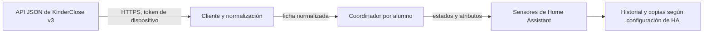

# Arquitectura y contrato de datos

## Alcance y flujo

KinderClose es una integración personalizada de Home Assistant, distribuida con la estructura que esperan el Marketplace de Home Assistant y HACS. No incluye servidor propio ni base de datos. Para cada alumno configurado se crea una entrada y un coordinador independiente:

La fuente es la API JSON que usa la app móvil oficial, obtenida por ingeniería inversa y descrita en [api.md](api.md). No es una API pública: KinderClose puede cambiarla sin aviso. Las pruebas usan respuestas simuladas; `scripts/probe_api.py` permite comprobar la API real.

- **Configuración.** El flujo inicia sesión con el correo y la contraseña, obtiene los alumnos de la cuenta y ofrece los activos que aún no están configurados. Si solo queda uno, se crea directamente. El token de dispositivo obtenido se guarda en la entrada.
- **Actualización.** El coordinador consulta cada 15 minutos con un cliente `aiohttp` asíncrono. Normalmente es **una única petición JSON**: la ficha de hoy. La lista de alumnos se comprueba al arrancar y, después, cada 6 horas. El JSON ocupa pocos KiB y se procesa en el bucle de eventos sin bloquearlo; ya no hay análisis de HTML ni dependencias externas.
- **Última ficha.** Si hoy no hay ficha, el cliente retrocede día a día hasta 7 días (fines de semana y puentes). Las fichas de días pasados se recuerdan en memoria, así que cada día solo se piden una vez. Si no hay ninguna en ese periodo (por ejemplo, en vacaciones), los sensores quedan desconocidos, no como errores.
- **Cuenta compartida.** Las entradas con la misma cuenta comparten cliente y token (`account.py`). Un candado evita inicios de sesión simultáneos. Si KinderClose rechaza el token, se inicia sesión una sola vez y el nuevo token se guarda en todas las entradas de la cuenta. Si se rechazan las credenciales, Home Assistant pide reautenticación.
- **Red.** La sesión HTTP es propia y no guarda cookies, separada de la compartida de Home Assistant, y se cierra al descargar la última entrada que la usa. No se siguen redirecciones y se rechazan respuestas de más de 1 MiB.
- **Baja.** Al eliminar la última entrada que usa un token, se cierra la sesión de ese dispositivo en KinderClose.

## Datos y semántica

`fetch` devuelve `alumno_id`, `alumno` (nombre de pila), `consultado_en` (UTC, ISO 8601) y `ficha`, que es `null` si no hay ninguna ficha en los últimos 7 días. La ficha normalizada tiene esta estructura:

| Campo | Significado y tratamiento |
| --- | --- |
| `fecha`, `url` | Fecha ISO de la ficha, en la zona horaria de Home Assistant, y enlace a la ficha en la web. No es necesariamente el día actual. |
| `presencia` | `ausente` y `ausencia_justificada` (booleanos); `hora_entrada`, `hora_salida`, `hora_entrada_tarde` y `hora_salida_tarde` en `HH:MM` o `null`. |
| `comidas` | `desayuno`, `primero`, `segundo`, `postre` y `merienda`: `Todo`, `Bastante`, `Poco`, `Nada` o `null`. |
| `sueno` | Siestas con `desde` y `hasta` (`HH:MM` o `null`). |
| `sueno_minutos` | Suma de las siestas en minutos; `null` si no hay siestas o alguna está incompleta. Admite el cruce de medianoche. |
| `deposiciones` | Lista de `tipo` (`Deposición` o `Pis`), `hora` e `info`. |
| `biberones` | Lista de `hora` y `cantidad` (ml). |
| `recordatorios` | Textos de lo que hay que llevar: `Toallitas`, `Pañales`, `Agua`, `Muda` o un texto personalizado del centro. |
| `control_esfinter` | `Sí`, `No` o `null`. |

| Sensor | Estado | Atributos propios |
| --- | --- | --- |
| `ultima_ficha` | Fecha de la ficha (`date`) | `ficha` (completa), `consultado_en` |
| `asistencia` | `presente` o `ausente` | `ausencia_justificada` (solo si está ausente) |
| `entrada`, `salida` | `HH:MM` | `entrada_tarde`, `salida_tarde` |
| `desayuno`, `primero`, `segundo`, `postre`, `merienda` | Texto de la comida | — |
| `sueno` | Minutos (duración) | `sesiones` |
| `deposiciones` | Número | `detalles`, `control_esfinter` |
| `biberones` | Número | `detalles` |
| `recordatorios` | Número | `elementos` |

Todos los sensores tienen `fecha_ficha` y `url_ficha`. Si no hay ficha, los estados son desconocidos y esos atributos, `null`. Una lista vacía da cero; la falta de siestas da un sueño desconocido, no cero.

Los nombres visibles se traducen con `translation_key`. Los `entity_id` (`sensor.kinderclose_<ID>_<clave>`) se fijan explícitamente para que no dependan del idioma. Los identificadores, nombres, unidades y atributos son una interfaz para tarjetas y automatizaciones. Cualquier cambio requiere evaluar la compatibilidad, añadir pruebas y, cuando corresponda, una guía de migración. Véase [mantenimiento](maintenance.md).

## Ciclo de vida y privacidad

Las credenciales y el token de dispositivo se guardan en los datos de la entrada de configuración de Home Assistant. Las respuestas y los atributos pueden contener datos sensibles de menores. Los atributos `ficha`, `sesiones`, `detalles`, `elementos`, `url_ficha` y `consultado_en` se excluyen del recorder (`_unrecorded_attributes`); los estados y `fecha_ficha` sí se registran. El almacenamiento y la retención dependen de la configuración de Home Assistant, sus integraciones y sus copias; este repositorio no tiene una política de borrado propia. Eliminar una integración o una entidad no prueba que se haya borrado su historial ni todas las copias. Revisa el acceso, el recorder, las copias y la recuperación en tu instalación. No uses datos reales en incidencias ni pruebas.
